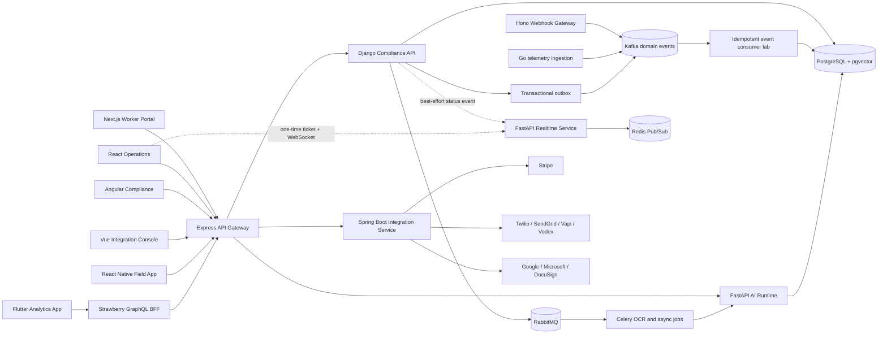

# OpsBridge architecture

OpsBridge is one tenant-aware operations product with role-specific interfaces and services selected by bounded business responsibility. The stack focuses on technologies that expand beyond the owner's existing professional experience.

## Design rules

- PostgreSQL owns onboarding cases, decisions, and audit records. pgvector stores policy embeddings. MongoDB, MySQL, Oracle, DynamoDB, Elasticsearch, Neo4j, and Memgraph have bounded adapter labs rather than being competing sources of truth.
- Kafka is for durable domain-event streams; RabbitMQ is for retryable Celery jobs; NATS is an additional internal messaging exercise; SQS/SNS are AWS cloud queue/notification adapters.
- The optional Kafka consumer lab writes a minimal tenant-scoped event projection with an idempotency key and a dead-letter topic. It commits offsets after its database transaction; delivery remains at-least-once.
- AI can extract, retrieve, summarize, and recommend. It cannot approve, reject, or perform an external side effect without an explicit human decision. Low confidence, missing evidence, or conflicting details are escalated.
- Every tenant-owned query is scoped to the verified tenant claim. Local mock identities and header-based tenancy are development-only.
- Webhooks verify provider signatures before accepting events. API routes enforce payload size, input validation, rate limits, origin checks, and idempotency for payment creation. The gateway uses a shared Redis-backed rate-limit store in Compose/production; local runs without `RATE_LIMIT_REDIS_URL` use the in-memory development store.
- Document content and credentials are not written to application logs. Use synthetic portfolio data only.

## Technology allocation

| Product responsibility | Technology |
|---|---|
| Worker self-service | Next.js |
| Operational overview | React + Vite |
| Compliance review | Angular |
| Connector administration | Vue + Vite |
| Field intake | React Native / Expo |
| Mobile analytics | Flutter / Dart via GraphQL BFF |
| API edge, OIDC validation, rate limiting | Express / JavaScript |
| GraphQL API composition | Strawberry GraphQL / FastAPI |
| Workflow/case records, admin, audit, tenancy | Django REST Framework |
| Async extraction, retries, scheduled outbox publish | Celery + RabbitMQ |
| Agent runtime, hybrid RAG, extraction, evaluations | FastAPI + LangGraph + pgvector |
| External webhook intake | Hono + Kafka |
| Billing, communication, external SaaS adapters | Spring Boot; Twilio and Meta WhatsApp Cloud API are separate routes |
| High-volume telemetry entry | Go |
| Durable Saga learning lab | Python standard library + SQLite; isolated onboarding steps and compensations |
| CQRS learning lab | Python standard library + separate SQLite command and query stores with an event projection |
| Service discovery/config learning lab | Spring Cloud Netflix Eureka, Config Server, and LoadBalancer across two synthetic providers |
| Optional Java labs | Spring Data JPA/Hibernate + Maven; Spring Cloud Circuit Breaker + Resilience4j |

The realtime channel is only a best-effort refresh hint. The dashboard reloads case state from the gateway; Kafka and PostgreSQL remain authoritative. Flutter, frontend patterns, careers, Spring Data, Spring Cloud, the Saga and CQRS labs, AutoGen, and Semantic Kernel examples are learning surfaces, not duplicate owners of onboarding data. Saga and CQRS use synthetic local effects; the discovery/config topology is an isolated provider-calling exercise. None of these labs are part of the production onboarding path.

## Data and event ownership

The compliance service is the authority for cases and their audit timeline. It writes business changes and outbox rows in the same PostgreSQL transaction. A Celery beat publisher sends pending outbox records to Kafka and records successful publication, so a Kafka outage does not discard an accepted case. Document files are stored locally in development or S3 in cloud deployment. Derived search and analytics data can be rebuilt from the primary records and events.
