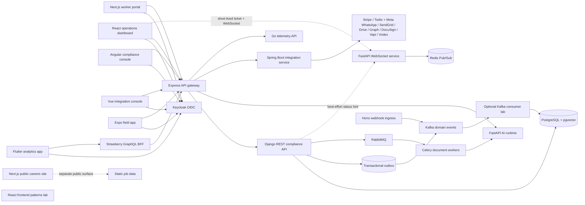

# OpsBridge: final product and architecture plan

## Purpose

Build one believable, explainable portfolio product that demonstrates practical experience across a broader hiring stack. The product is OpsBridge, a tenant-aware workforce onboarding and compliance workflow. A worker submits profile information and evidence; the system extracts document fields, checks policy, routes uncertain cases to a person, records the final decision, and can communicate with external business systems.

The strongest interview story is the complete business path and the engineering decisions behind it. The extra technology is arranged in bounded responsibilities and optional labs so the repo does not pretend every database or queue is needed for the same task.

## Product workflow

1. A worker or field operator starts an onboarding case and uploads an identity or work eligibility document.
2. The API validates identity, tenant, file type, and size; the compliance service persists the case, audit event, and outbox event.
3. A Celery worker extracts text from PDF, image, or text documents, asks the AI runtime for structured fields, and stores confidence and warnings.
4. Deterministic checks flag missing fields, low confidence, name mismatches, or expired documents. Retrieval can attach relevant tenant policy excerpts. The AI returns an advisory route only.
5. A compliance reviewer inspects evidence and makes the final decision. The API stores the actor, reason, case version, and audit trail.
6. The outbox publisher sends confirmed domain events to Kafka. Integrations can then perform consent-checked messaging, document handoff, billing, or other explicitly triggered work.

## Architecture and ownership

| Responsibility | Selected technology | Source of truth / boundary |
|---|---|---|
| Worker self-service | Next.js | Worker profile and upload experience |
| Operations overview | React + Vite | Read-heavy operational queues and summaries |
| Compliance review | Angular | Human review and decision workflow |
| Integration administration | Vue + Vite | Connector configuration and billing entry points |
| Field intake | React Native + Expo | Mobile case intake, file selection, and camera capture; uses the same gateway and identity provider |
| Mobile analytics | Flutter + Dart | Independent cross-platform dashboard using the GraphQL BFF and the same API identity |
| API edge | Express | OIDC/JWT verification, role checks, Redis-backed shared rate limits in Compose/production (in-memory fallback for local development), request routing, correlation IDs |
| GraphQL composition | Strawberry + FastAPI | Mobile/dashboard aggregation layer; forwards user JWT to the authoritative gateway |
| Case workflow | Django REST Framework | Canonical case, document metadata, audit history, decisions, transactional outbox |
| Background jobs | Celery + RabbitMQ | OCR/extraction jobs, retry and scheduled outbox publication |
| AI features | FastAPI + LangGraph | Extraction, tenant-filtered hybrid policy retrieval, advisory recommendation, voice summary, basic evaluation endpoint and offline RAG benchmark |
| External callbacks | Hono | Provider signature validation and event intake |
| Enterprise adapters | Spring Boot | Stripe, messaging, storage, e-signature, CRM/HRIS expansion points |
| API-led integration lab | MuleSoft APIkit | Separate contract-first process API calling the Django system API; run only behind trusted gateway/API Manager auth |
| Telemetry edge | Go | Lightweight health, metrics, and telemetry ingestion |
| Realtime status hints | FastAPI + Redis Pub/Sub | Tenant-scoped transient WebSocket notifications; clients reread authoritative state |
| Event consumer lab | Confluent Kafka consumer + PostgreSQL | Idempotent sanitized projection, manual offset commits and DLQ for invalid records |
| Business Saga lab | Python standard library + SQLite | Durable orchestration journal, idempotent synthetic effects, reverse-order compensation and restart recovery; isolated from the canonical workflow |
| CQRS lab | Python standard library + separate SQLite databases | Transactional command/event log, asynchronous tenant-scoped query projection, idempotent consumer checkpoint and projection replay |
| Spring data lab | Spring Data JPA/Hibernate + Maven | Isolated synthetic workflow demonstrating ORM and persistence |
| Spring Cloud lab | Spring Cloud Circuit Breaker + Resilience4j | Isolated synthetic provider failure and fallback demonstration |
| Discovery/config lab | Spring Cloud Config + Eureka + LoadBalancer | Centrally configured caller discovers and balances requests across two synthetic provider instances |
| AI framework lab | AutoGen + Semantic Kernel | Advisory comparison examples, no action tools |

### Data and messaging rules

- PostgreSQL is the only authoritative business database. pgvector is an extension in that database for policy retrieval, not a second system of record.
- MongoDB, MySQL, Oracle, DynamoDB, Elasticsearch, Neo4j, and Memgraph are isolated connector labs. They are not duplicated stores for onboarding cases.
- RabbitMQ carries retryable document and scheduled work. Kafka carries domain events and integration/webhook events. NATS and AWS SQS/SNS are optional adapter labs with explicit examples, not extra queues in the core path.
- Document bytes live in local storage for development and S3 for a cloud configuration. Case metadata and audit history stay in PostgreSQL.
- The outbox row is written in the same transaction as a business change. It is marked delivered only after Kafka confirms the message.
- Each tenant's API query is scoped using the validated identity claim. Services trust tenant context only from the gateway over a protected internal hop.

### AI and human control

- LLM providers are replaceable through one provider boundary. Mock mode is safe when no key is configured; OpenAI, Gemini, and Anthropic are provider options.
- Retrieval uses tenant-filtered policy chunks. Every recommendation can expose policy sources, missing fields, and review flags.
- Deterministic validation owns expiry, required-field, confidence-threshold, and profile-name checks. The model does not make an employment decision.
- A person makes every final approve/reject/request-changes decision. Agent execution is planning-only until a separately approved adapter is added.
- Use synthetic records only. Do not upload real identity documents to this portfolio deployment.

## Integrations and delivery boundaries

The integration service has concrete provider adapters and configuration gates for Stripe Checkout/customer portal, Twilio WhatsApp, a Meta WhatsApp Cloud API template route, SendGrid, Google Drive, Microsoft Graph, DocuSign draft envelopes, Vapi calls, and Vodex call-trigger/transcript endpoints. Hono handles provider callback signatures. Each live provider still requires sandbox credentials, account setup, webhook registration, durable consent evidence/audit, and an end-to-end scenario check. Current Google/Microsoft/DocuSign token configuration uses supplied access tokens; a full production OAuth consent and refresh-token lifecycle is a follow-up before claiming a production-ready connector. Calls and messages must remain explicit user actions with consent and audit records.

MuleSoft is represented by an isolated APIkit process API exercise in `services/mulesoft-process-api-lab/`; it demonstrates a RAML contract, routing, forwarding to Django's case system API, and DataWeave response mapping. It is not imported or run in Anypoint Studio and is not a deployed integration layer. Vodex call-trigger and transcript routes now use the published API contract; its account-specific credentials, callbacks, and a live sandbox run remain follow-up work.

Infrastructure is provided as learning/deployment references at different depths:

- Docker Compose is the local integration environment, with optional profiles for frontends, data stores, identity, dashboards, and adapter labs. The OpenTelemetry Collector is part of the core services because the gateway and Python workflow services export OTLP traces to it.
- Terraform now defines an AWS ECS/Fargate slice for ten services, including the core gateway/compliance/AI/integration services, Celery worker and singleton beat, realtime WebSocket service, and Kafka projection consumer. HTTPS ALB routing sends `/ws/*` to realtime; the rest reaches the API gateway. PostgreSQL, S3, SQS/SNS, private service discovery, CloudWatch logs, ECS CPU scaling, deployment rollback, and per-service ECS task roles are configured. Only the compliance API and Celery worker receive S3 document permissions. ECS tasks and RDS use private subnets and have no public IP. Mock Terraform tests check network isolation, workflow wiring and task-role scope. Private-subnet NAT/VPC endpoints remain operator prerequisites. RabbitMQ, Redis/Valkey and Kafka clusters remain externally managed: the root accepts their private endpoints and Secrets Manager URLs but does not provision them. Full Prometheus/Grafana/Collector hosting, migration release sequencing, and credentialed cloud plan/apply still need deployment-specific work and evidence. The operator supplies VPC/subnets, certificate, API origin, frontend origins, image URIs, identity issuer, broker endpoints, and secret ARNs.
- GCP Cloud Run/Artifact Registry remain a narrow Go telemetry deployment lab. A separate opt-in Terraform lab now represents GKE Autopilot and Secret Manager CSI with Workload Identity access scoped to one Kubernetes service account and one secret; mocked tests verify its disabled-by-default behavior and IAM policy. No cloud resources have been applied.
- `infra/cloud-labs/aws-services/` is a separate opt-in Terraform root for EC2, EKS, and private Route 53. All three resource groups default to disabled, use an existing VPC/network, and stay out of the main ECS deployment. EKS and Route 53 incur ongoing charges while enabled; the Terraform configuration validates locally but has not been planned with valid AWS credentials or applied.
- CDK demonstrates secure S3, SQS/DLQ, SNS, and KMS resource patterns; it is a focused lab, not another competing production stack.
- An explicitly opt-in CDK stack demonstrates API Gateway + Lambda + Step Functions, CloudFront/S3, ECR, and a dormant Glue Python Shell job. It is not included in the default CDK app invocation and has not been synthesized or deployed.
- Kubernetes manifests are examples for the API edge and core services, not a complete platform install.
- OpenTelemetry instrumentation covers the Node API gateway and Python compliance, Celery, and AI request path; the Collector currently prints spans through its debug exporter. A gateway smoke test verifies W3C trace propagation and OTLP span export. Prometheus/Grafana include demo 30-day SLO rules and a provisioned dashboard, while Alertmanager routes notifications to the local Mailpit inbox and CI verifies a synthetic alert. Production still needs a searchable trace backend, a real notification receiver, and service-owner-approved SLOs and retention choices fitted to deployment. See `docs/observability-runbook.md`.
- Optional stack labs are launched separately from the core product. Use `--profile spring-cloud-labs` for the Spring Cloud circuit-breaker simulator; `DEMO_SIMULATE_FAILURE=true` makes its synthetic provider fail. Build the discovery/config topology with `mvn -f services/spring-cloud-discovery-lab/pom.xml package`, then follow `services/spring-cloud-discovery-lab/README.md` to start the Eureka + Config Server + two providers + LoadBalancer caller topology. Never treat these labs as production provider policies.
- Use `--profile event-consumer-lab` for the Kafka-to-PostgreSQL projection. Kafka delivery is at-least-once; event-ID deduplication protects the database side effect.

This split keeps the interview explanation honest: core workflow code is implemented in this repo; external accounts and production operations are configurable boundaries, not evidence of a live customer deployment.

## Build and AI-assisted delivery strategy

The repo's implementation follows vertical slices, keeping each technology attached to a demonstrable outcome:

1. **Foundation:** contracts, tenant/role model, gateway, canonical Django data model, migrations, audit trail, and compose services.
2. **End-to-end case:** worker intake, file upload, storage, Celery processing, AI extraction, deterministic checks, review console, and final decision.
3. **Reliable events:** transactional outbox, Kafka publication, signed webhook ingress, correlation IDs, retries, and observable failure paths.
4. **Integrations:** connector catalog and guarded Stripe, communication, cloud document, e-signature, and voice adapters. Start with Stripe sandbox and one consent-checked communication path for a short demo.
5. **Stack breadth:** role-specific React/Angular/Vue/mobile UIs, alternate provider adapters, optional databases/queues, and cloud/IaC examples. Keep adapters independent from core case ownership.
6. **Shared client library:** React operations, Next.js worker intake and Angular compliance review use the same workspace TypeScript API SDK for listing, creating, uploading and deciding cases. Generate request/response types from the OpenAPI contract, build ESM and declaration files, test transport/auth/error behavior and reviewer decisions, and verify package contents with `npm pack --dry-run`; keep public publishing/version release as a later step after an external consumer compatibility check.
7. **AI-generated verification and release:** have Codex generate and maintain unit/API/contract/integration/E2E suites, execute them against Compose with sandbox services, inspect failures, remediate, and produce a verification report. A fast Django REST API suite runs against isolated SQLite and mocks Celery dispatch. The hosted Compose browser job is configured to exercise PostgreSQL, RabbitMQ, a separate Celery worker, the AI runtime's safe default/mock provider path, Kafka outbox publication, and the Kafka-to-PostgreSQL projection. A follow-up assertion waits for the worker workflow's case-created, document-received, document-processed, and recommendation events and confirms projected summaries exclude direct identifiers. It writes a JSON report as a CI artifact. The job still needs a successful hosted run before these boundaries count as verified. Add security checks, dependency review, migration backup/rollback notes, and deployment runbook before publishing a live demo.

Use Codex for bounded changes with acceptance criteria and file ownership: one vertical feature, one service owner, one contract change, then update docs and the demo script. Ask it to summarize diffs and risks before the next slice. Keep provider credentials outside prompts and logs. AI-assisted verification has started: selected service checks and frontend production builds are being run and recorded. Docker-based E2E, provider sandbox flows, cloud plans and deployment verification still require their corresponding local tools, credentials, or cloud accounts.

The web frontend build is a shared CI gate exposed as `npm run build:frontends`. GitHub Actions has the Compose-backed browser workflow; Jenkins, GitLab CI, and Bitbucket Pipelines have build-only examples that use the same command. Claude Code project guidance, a reusable vertical-slice skill, a read-only reviewer, and a post-edit JSON syntax feedback hook are included alongside this Codex-oriented workflow. Auto-memory is a local Claude Code session feature and must be checked in that application. See `docs/ci-cd-labs.md`; provider-hosted execution is not claimed until those pipelines run on their own services.

## Interview narrative

Lead with the business problem and the human-safe case lifecycle. Then trace one case through the portal, Express gateway, Django/PostgreSQL, Celery/RabbitMQ, FastAPI/LangGraph, reviewer console, and Kafka outbox. Explain why PostgreSQL owns the record, why work queues and event streams differ, how tenant isolation and role checks are enforced, where a model is advisory, and how a Stripe sandbox flow is protected by allow-listed return URLs and idempotency. Show provider credentials as configuration and distinguish code paths from a live verified provider account.

For role-specific interviews, use the same product and choose one deep slice: Python/Django and AI for Python roles; Spring and webhooks for Java roles; Go telemetry for Go roles; TypeScript gateway/frontends for JS roles; Terraform/CDK/Kubernetes for platform roles. Be ready to explain the implementation, trade-offs, failure handling, and what was verified, rather than presenting the number of frameworks as the achievement.

## Current repo scope and deferred verification

This repo contains the product surfaces, core backend services, contracts, local environment, identity configuration, provider adapters, labs, and cloud/deployment examples described above. It is a broad portfolio implementation, so the next engineering pass should prioritize coherent end-to-end execution and correctness fixes over adding more technologies. Verification is partial: the Spring Data synthetic-screening JUnit test passes locally and is configured in CI; the no-Docker worker-to-review Playwright workflow passes in Chromium, Firefox, and WebKit with eager Celery and deterministic mock AI. The Python compile check, JSON parsing, JavaScript syntax checks, and the worker portal, careers site, Angular compliance console, Vue integration console, React operations dashboard, and frontend-patterns production builds have passed. Go telemetry handler tests with race detection, vet, and build pass in WSL Ubuntu with GCC using a temporary Go 1.27.4 toolchain; hosted CI is configured but pending. Flutter 3.50 formatting, analysis and two widget tests pass locally; Android/iOS platform projects and AppAuth callback scheme are configured, and a local Android debug APK build passes. The hosted Android CI run is pending; iOS device build/signing and OIDC flows remain unverified. Docker E2E could not run because Docker is unavailable. Provider credentials, cloud accounts, iOS platform tooling and production operations remain prerequisites for their respective end-to-end checks. Mobile OIDC requires a native build with the configured redirect scheme and a reachable issuer URL; the development header fallback is for local-only use. See `docs/development.md` for local identity setup and `docs/job-description-skill-gap.md` for the detailed verification status.
