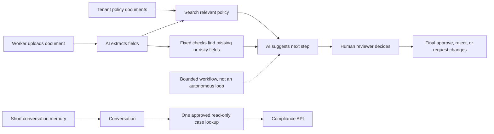
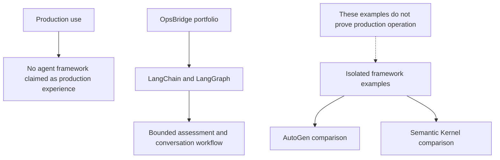
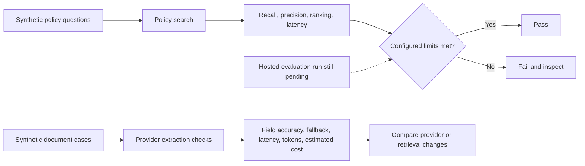
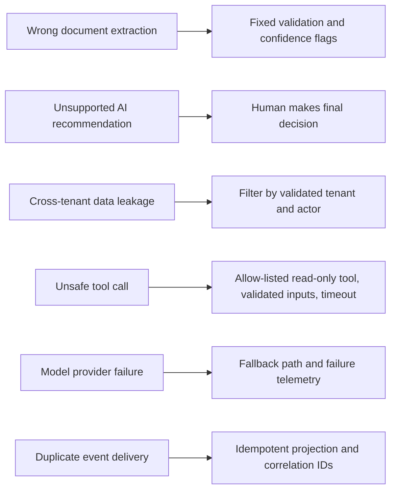
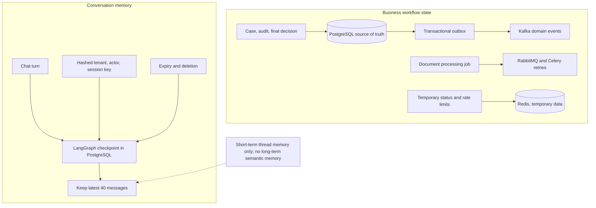

# Application answers: Senior AI Agent Engineer

Prepared 2026-11-21 for the Screenloop listing shared by the project owner. These answers describe OpsBridge as an educational portfolio implementation. They do **not** claim that it is deployed in production or used by customers. Edit personal details and any statement that does not match your own work before submitting.

## Copy-ready written answers

### Describe one agent or AI system you architected end-to-end. Include planner/reasoning loop, tool use, memory/state, evaluation, and how it behaved in production.

I built an educational portfolio system called OpsBridge, which assists with worker onboarding and document review. Its AI path extracts structured document fields, retrieves tenant-scoped policy passages, applies deterministic checks for missing or expired fields, low confidence, and profile mismatches, then returns an advisory next step for a human reviewer. The main LangGraph workflow is a bounded sequence of assessment and recommendation nodes, not an open-ended autonomous planner/replanning loop. A separate conversation graph checkpoints thread state and can call one allow-listed, read-only case-summary tool; there are no AI-controlled write actions.

LangGraph state is stored through a PostgreSQL checkpointer when configured. Thread IDs are derived from tenant, actor, and session identifiers, stored messages are bounded to the latest 40, and expired threads can be deleted. The evaluation work includes a synthetic retrieval set and provider-reliability harnesses for retrieval quality, latency, extraction accuracy, fallback behavior, tokens, and estimated cost. This is a portfolio project, not a production deployment, so I cannot claim production traffic or customer outcomes. The full hosted Docker evaluation is configured but still needs a successful hosted run.

### Which agent frameworks/orchestration stacks have you used in production? Mention what you used each for.

I have not operated an agent framework in production yet. In my OpsBridge portfolio implementation, I use LangChain/LangGraph for bounded document-policy assessment and a PostgreSQL-checkpointed conversation workflow. I also created isolated AutoGen and Semantic Kernel comparison examples to learn their orchestration patterns. These are portfolio examples; I do not present them as production usage.

### Describe an evaluation or harness system you built for AI/agent workflows. What did it measure, how did you define success/failure, and how was it used to improve the system?

I added two synthetic evaluation paths to OpsBridge. The retrieval harness uses a labeled policy-question set and reports Recall@5, Precision@5, mean reciprocal rank, p95 latency, reranker activity, and a cross-tenant isolation probe. Configurable quality and latency thresholds determine pass/fail, and the runner exits nonzero when a threshold is missed. It supports comparing the default reciprocal-rank-fusion retrieval with optional cross-encoder reranking.

The provider-reliability harness evaluates synthetic document-extraction cases across configured model providers. It reports exact-field accuracy, completion and fallback rates, p95 latency, token counts, estimated cost, and failure attribution. Unit tests also exercise fallback and scoring behavior. The harnesses are intended to make retrieval and provider changes measurable rather than relying on a few manual outputs. The golden set is small and not human-validated, and the first hosted retrieval/memory evaluation run and credentialed live-provider comparison are still pending; I would not claim validated model quality from them yet.

### What were the most important failure modes in an agent or AI system you built, and how did you mitigate them?

The main risks I designed for were incorrect extraction, unsupported recommendations, cross-tenant retrieval or tool access, provider timeouts/failures, and unsafe tool execution. I keep deterministic checks in control of required fields, confidence thresholds, name mismatches, and expiry; model output is advisory and every final decision remains with an authorized reviewer. Retrieval and the read-only case tool receive validated tenant context, and the tool is allow-listed, validates its arguments, uses a timeout, and returns a minimized case summary. Provider attempts record bounded outcome, latency, fallback, and error-type telemetry, with a configured fallback path. For asynchronous processing, the workflow uses durable case/outbox state, retries, correlation IDs, and idempotent event projection patterns. These mitigations have unit or local workflow coverage in the repo, while full broker-backed hosted behavior remains to be verified.

### How did you handle memory/state for long-running tasks?

I separate business workflow state from conversational context. PostgreSQL is the source of truth for cases, audit history, decisions, and the transactional outbox; Celery/RabbitMQ handles retryable document-processing jobs, and Kafka carries domain events. The conversational workflow uses LangGraph checkpoints in PostgreSQL, with a thread key scoped by hashed tenant, actor, and session identifiers. It keeps at most 40 recent messages and supports expiry/deletion. This is bounded, thread-level short-term memory, not long-term semantic memory or a fully autonomous agent that can resume arbitrary multi-day plans. Persistence across an AI-container restart is covered by a configured CI check, but its hosted run is not yet verified.

## Form fields that need your personal information

Do not copy invented values into these fields:

- **Name, email, phone, location, LinkedIn, resume:** enter your real information and attach your current resume.
- **Current CTC:** since you said you are not employed right now, use “Not currently employed” or “N/A” if accepted. If the form requires a numeric amount, confirm the expected format with the recruiter rather than entering a fabricated salary.
- **Expected CTC (£):** research/choose your own amount and confirm whether they mean annual base salary. Do not convert a guessed INR amount without checking the form's convention.
- **Preferred work location:** choose Mumbai or Bangalore based on your real willingness to work onsite; the listing says Bangalore onsite.
- **Total experience:** enter your actual employment experience, not time spent building OpsBridge.
- **Notice period:** choose “Can join immediately” only if that is factually true; you said you are currently not employed, but confirm any contractual obligations.
- **Recent work:** based on the information shared so far, “Early-career / learning-focused experience” is the most honest option if your recent AI-agent work is this portfolio project. If your recent paid work better matches one of the other descriptions, choose that based on your actual role.
- **Open-source agents/GitHub:** this workspace has agent examples but it has not been published to a public GitHub repository yet. Do not claim it is open source or provide a private/local path. Publish the repo first if you want to share a public link, then replace this note with that verified URL.
- **Consent:** select only if you agree to the employer's stated personal-information use.

## Accuracy notes before submitting

- This job is titled **Senior** and asks specifically for production experience. The project evidence supports portfolio-level architecture and implementation, not production ownership. The answers state that distinction directly.
- Do not change “portfolio” to “production,” claim a live deployment, claim customer use, or imply that AutoGen/Semantic Kernel are used in the core application.
- The current repository has no configured Git remote, so there is no public OpsBridge URL to paste yet.

## Visual explanations

These diagrams explain the five written answers in plain language. “Portfolio” means code and local/CI examples in this repo; it does not mean production deployment.

### 1. What the AI system does

**In simple words:** AI reads and organizes information, rules flag issues, then a person makes the real decision. The tool can look up limited case details but cannot change the case.

### 2. Which frameworks are used where

**In simple words:** LangGraph is used in the project. AutoGen and Semantic Kernel are learning examples. None are claimed as production experience.

### 3. How AI quality is checked

**In simple words:** Give the system known sample questions and documents, measure the results, and fail checks when configured quality or speed limits are missed. The datasets are small and the hosted run is still pending.

### 4. Main risks and protections

**In simple words:** The system expects that models, services, or messages can fail. It limits what AI can do, checks important fields with ordinary rules, and leaves decisions to a person.

### 5. Where the system remembers information

**In simple words:** The real case data and conversation history are different. The case database records business facts; the chat remembers only a bounded recent thread. Background work and events are tracked separately so they can retry or be processed later.
